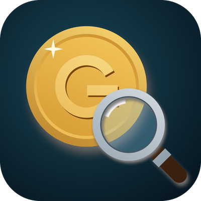
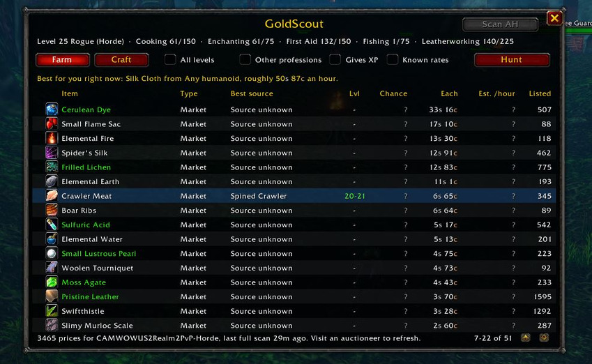
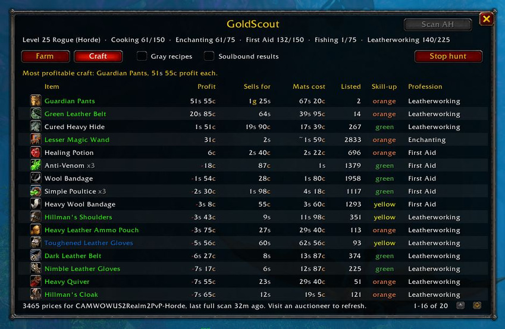
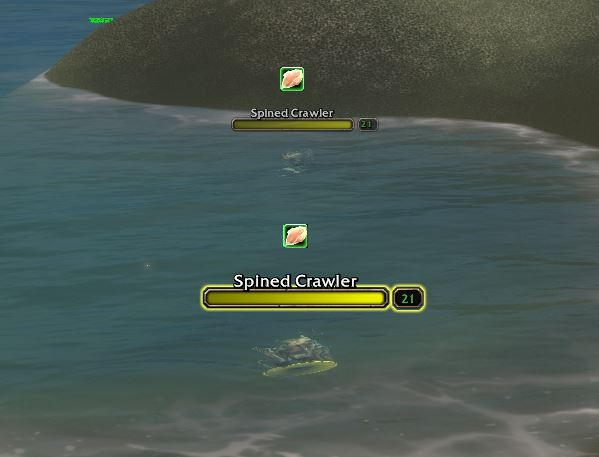

  

<h1 align="center">GoldScout</h1>

  <b>What should <i>this</i> character farm for gold right now?</b> 
  A free World of Warcraft: Forever addon that ranks farms and crafts by gold per hour, 
  for the character you're playing, priced from your own auction house.

  
  
  
  
  

  
  

  

Log onto a level 12 druid herbalist or a level 31 rogue, open GoldScout, and you
get advice that fits that character: its level, class, faction and professions,
priced against your own realm's auction house.

## Features

- **Farm tab:** farms ranked by estimated gold per hour: mob drops, cloth,
  herbs, ore and leather your skills can gather, pickpocketing for rogues, and
  crafting reagents selling on your auction house right now.
- **Experience check:** see at a glance which farms still give you XP, so you
  can level and earn at the same time.
- **Craft tab:** every recipe you know, ranked by profit after the auction house
  cut and the cheapest cost of materials.
- **Hunt mode:** pick a farm and press **Hunt** for Blizzard's map waypoint to
  the spot, a marker over every mob that drops it, and a live panel of kills,
  loot, drop rate and gold per hour.
- **Price tooltips:** the latest auction price and listing count on every item,
  plus what it goes for at the Blackwater (goblin) auction houses.
- **Learns as you play:** every corpse you loot teaches GoldScout real drop
  rates, on all your characters.
- **Your language:** English, Deutsch, Français, 한국어 and 繁體中文, following
  your game's language. Mob and item names come from the game itself.

<table>
  <tr>
    <td width="50%"></td>
    <td width="50%"></td>
  </tr>
  <tr>
    <td align="center"><b>Craft tab:</b> every recipe you know, by profit</td>
    <td align="center"><b>Hunt mode:</b> the mobs you're after, marked</td>
  </tr>
</table>

## Prices every hour, without scanning

Press **Scan AH** at any auctioneer and GoldScout reads the whole auction house
in a few seconds. Or let the free **[GoldScout Companion](https://wowgoldscout.com/companion)**
do it for you: about once an hour it brings Blizzard's auction house snapshot
for your realm into GoldScout, for US, EU, Korean and Taiwanese realms. Your own
scans still win when they're newer. Until you have either, GoldScout uses
regional estimates that ship with each release, so the Farm list works the
moment you install it.

The companion runs quietly in the system tray on Windows, never pops up over
your game, and also shares what GoldScout learns from your loot, so the Farm
tab keeps getting better for everyone. (A macOS version runs from source; a
signed Mac app is planned.)

## Install

1. Get GoldScout from [CurseForge](https://www.curseforge.com/projects/1790110),
   [Wago](https://addons.wago.io/addons/QKyqnaK7) or the
   [Releases](https://github.com/Alkhara/GoldScout-WoW/releases/latest) page.
   For a manual install, unzip the `GoldScout` folder into
   `World of Warcraft\_forever_\Interface\AddOns\` and restart the game.
2. Optional but recommended: download `GoldScoutCompanion.exe` from the
   [latest release](https://github.com/Alkhara/GoldScout-WoW/releases/latest)
   and launch it. There's nothing to install; it finds your WoW folder itself.

## Getting started

Type `/gscout`: the Farm list is ranked straight away, and a short checklist
shows what's left to set up, ticking itself off as you go.

1. Prices for your own auction house: the companion brings them in, or press
   **Scan AH** at any auctioneer.
2. If you craft, open each of your profession windows once, so the **Craft**
   tab knows your recipes.
3. Pick a farm and press **Hunt**.

Type `/gscout` to open the window any time. The full guide, with every command
and setting, is in [GoldScout/README.md](GoldScout/README.md).

## Help build the data

GoldScout uses no data from Wowhead or any other site: every drop rate comes
from players looting in game. The more people share, the better the Farm tab
gets for everyone.

- **Automatically:** [GoldScout Companion](https://wowgoldscout.com/companion)
  shares new data after you agree to the terms once.
- **By hand:** type `/gscout export` in game, press **Ctrl+C**, and paste it
  into the [Share drop data](https://github.com/Alkhara/GoldScout-WoW/issues/new?template=data-submission.yml)
  form.

Exports contain no character or account names. Accepted data ships in the next
weekly release. See the [Contributor Terms](docs/CONTRIBUTOR_TERMS.md) and
[Privacy Policy](docs/PRIVACY.md).

## Plays by the rules

GoldScout only shows you information. It never moves, targets, attacks, loots
or clicks anything for you, and it respects every limit Blizzard puts on addons.
It's free, and every feature is the same for everyone. Auction data comes from
the Blizzard Entertainment Game Data API; GoldScout is a fan project, not
affiliated with or endorsed by Blizzard Entertainment.

## Contributing

Bug reports and ideas are welcome in
[Issues](https://github.com/Alkhara/GoldScout-WoW/issues). **Translations are
new**, so if a word reads wrong in your language, open an issue or edit the
matching `GoldScout/Locale_<language>.lua`. To work on the code, see
[CONTRIBUTING.md](CONTRIBUTING.md).

## License

The source code is MIT-licensed ([LICENSE](LICENSE)). The community drop data is
covered by the [GoldScout Data License](DATA_LICENSE.md): use it in GoldScout,
but don't extract or reuse it elsewhere without permission.
